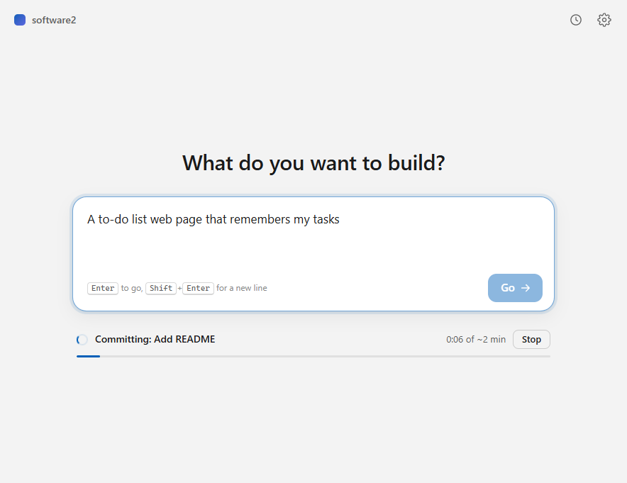
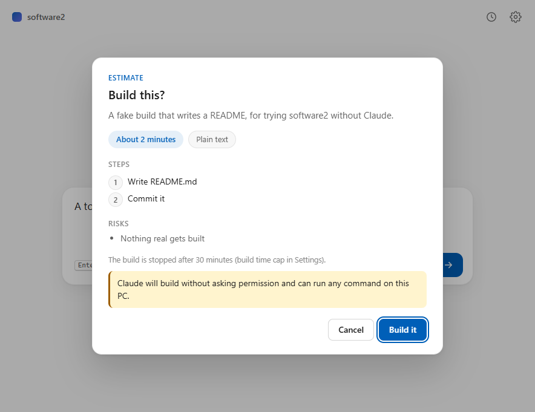
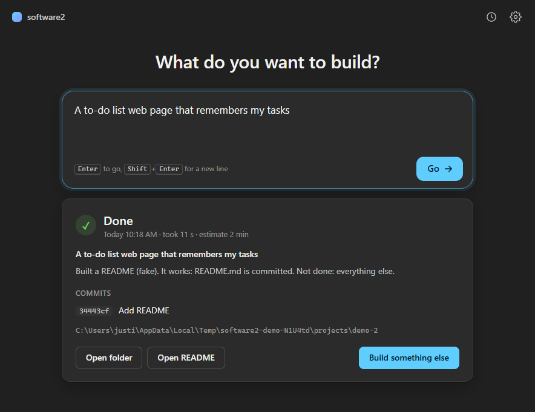

# software2

A proof-of-concept Windows app with one text box. You type the software you want,
the app asks Claude Code for a quick time estimate, you confirm and pick a new
folder, and Claude Code builds it in one go, headless, with local git only.

Behind the scenes it just pipes your request, plus some instructions, into the
`claude` CLI. Windows only for now.

Status: works end to end with the fake CLI (see the tests). The first run with the
real Claude Code is still to be done.

**Real builds use your own Claude Code login and count against your own plan's usage**
(or your API billing, if that is how your Claude Code is signed in). A build can run
for as long as the time cap in Settings, 30 minutes by default.



## How to use it

1. Type what you want, for example "a to-do list web page", and press **Enter** or
   **Go** (Shift+Enter starts a new line).
2. Read the estimate and press **Build it**, then pick or create a new, empty folder.
3. Watch the status line under the text box: what Claude is doing right now, the time
   against the estimate and a thin progress bar. **Stop** kills the build at any time;
   the time cap kills it too.
4. When it ends you get Claude's summary, the git commits it made, **Open folder**,
   **Open README** and **Build something else**. Past builds are behind the clock icon
   (**History**); click one to see its summary again, or **Open full log** for its log.

The window follows the Windows light or dark theme.

| Estimate | Result (dark theme) |
| --- | --- |
|  |  |

## About "build without asking permission"

The setting **Let Claude build without asking permission** is on by default. It passes
`--dangerously-skip-permissions`, which means: Claude can run any command on this PC
with your user's rights, without asking. It is told to stay inside the project folder,
but nothing enforces that. It could delete files elsewhere, install things, or use
the network. Only use it for requests you trust, and ideally on a PC or user account
without anything precious on it.

When it is off, the build runs with `--permission-mode acceptEdits` and a short
allow-list: Claude can edit files in the project folder and run only `npm`, `npx`,
`node`, `python`, `py`, `pip`, `dotnet` and `git`. Nobody is there to answer a
permission prompt in a headless run, so any other command simply fails and Claude has
to work around it. Some builds will not finish that way.

## What Go does

1. **Estimate** (60 s cap, spinner with the elapsed time): runs
   `claude -p --output-format json --tools "" --strict-mcp-config --no-session-persistence`
   in a temporary empty folder, so Claude can only answer, not act. It replies with JSON:
   minutes, summary, stack, steps and risks. Code fences and prose around the JSON are
   fine; if no estimate can be read, the raw reply is shown with Retry.
2. **Confirm**: a card with the summary, stack, steps, "About N minutes", the build time
   cap and, if the permission-skip setting is on, a warning. "Build it" or "Cancel".
3. **Folder**: a folder dialog opens at the default folder. Pick or create a new, empty
   folder; a non-empty one is refused. It gets `git init` and an empty first commit.
4. **Build** (time cap from Settings): runs
   `claude -p --output-format stream-json --verbose` in the project folder, plus either
   `--dangerously-skip-permissions` or
   `--permission-mode acceptEdits --allowedTools "Bash(npm *)" ...` (see above). The
   prompt goes in through stdin and comes from `prompts/build.md`: the request word for
   word, the estimate as a plan, and the rules (only this folder, no questions, commit
   after each step, a README, run the tests, end with a summary). Edit that file to
   change what Claude is told; it is read at every build.
5. **Status line**: one sentence for what Claude is doing now, taken from the stream:
   tool calls become "Writing src/app.js", "Editing ...", "Reading ...",
   "Running npm test" or "Committing: <message>"; Claude's text becomes its first short
   sentence, or "Thinking...". Updates are throttled so it does not flicker. Next to it:
   the elapsed time against the estimate ("3:12 of ~10 min", then "taking longer than
   estimated") and a progress bar.
6. **Full log**: everything (Claude's text, each tool call as one line, the first lines
   of each result, stderr) goes to a file per run, `%APPDATA%\software2\logs\run-*.log`
   (the last 100 runs), opened with **Open full log** in History.
7. **Result**: done, stopped, failed or timed out, saved to
   `%APPDATA%\software2\history.json` (the last 100 builds).

## Run it in dev

Needs Node 22 or newer and the [Claude Code CLI](https://docs.claude.com/en/docs/claude-code)
installed and signed in (only for real use; the tests never call it).

```
npm install
npm start
```

`npm start` compiles the TypeScript into `dist/` and opens the window. If Electron
says it failed to install correctly, its download step was skipped; run
`node node_modules/electron/install.js` once.

```
npm test
```

builds and runs the tests (`node:test`). They use `test/fake-claude.mjs`, a tiny
stand-in for the CLI, never the real one.

### Demo mode and screenshots

Off by default. `SOFTWARE2_DEMO=1` runs the window against `test/fake-claude.mjs`, with
a throwaway data folder in `%TEMP%\software2-demo-*` (your real settings and history are
not touched) and no folder dialog. `SOFTWARE2_SHOTS=<folder>` also walks through every
state (empty, estimating, confirm, building, done, Settings, History) in light and dark,
saves a PNG of each into that folder and quits. In Git Bash, after `npm run build`:

```
SOFTWARE2_SHOTS=shots node_modules/electron/dist/electron.exe .
```

`SOFTWARE2_THEME=light|dark` forces a theme in plain demo mode.

## Settings

Open **Settings** with the gear icon. They are saved as JSON in the app's own folder,
`%APPDATA%\software2\settings.json`:

- **Claude CLI**: path to `claude.exe` or `claude.cmd`. Found on PATH automatically;
  use Detect or Browse to change it. A `.js`/`.mjs` script also works (it is run
  with Node), so you can point it at `test/fake-claude.mjs` to try the app without
  Claude.
- **Default folder for new projects.**
- **Build time cap** in minutes (default 30). The build is killed when it runs out.
- **Let Claude build without asking permission** (`--dangerously-skip-permissions`),
  on by default. See above for what that means and what happens when it is off.

## Layout

```
src/main/main.ts        Electron main process: window, IPC, settings, Go/Stop
src/main/runner.ts      runClaude(): spawn the CLI, stream lines, Stop, time cap
src/main/settings.ts    load/save settings.json, find claude on PATH
src/main/flow.ts        Go: estimate -> confirm -> folder -> build (Electron bits passed in)
src/main/estimate.ts    the estimate run and parsing its JSON reply
src/main/project.ts     the empty-folder check and git init
src/main/build.ts       runBuild(): the build run, its flags and its prompt
src/main/stream.ts      stream-json lines -> readable log lines and the status-line sentence
src/main/history.ts     history.json: past builds
src/main/runlog.ts      the full log file per run (userData\logs)
src/main/demo.ts        demo mode and the screenshot walk-through (off by default)
prompts/build.md        the build prompt (editable)
src/preload/preload.ts  the small window.api the page gets
src/renderer/           index.html, styles.css, renderer.ts (plain script, no framework)
src/api.d.ts            types for window.api
test/fake-claude.mjs    fake claude CLI for tests
test/*.test.mjs         tests (run against the compiled dist/)
docs/screenshots/       screenshots from the demo mode
```

## Build a Windows exe (later)

Not set up yet. The plan is [electron-builder](https://www.electron.build/) as a dev
dependency with a `dist` script, for example `electron-builder --win portable`, which
writes a single `.exe` into `release/`.
